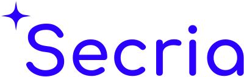

  <a href="https://secria.me">
    <picture>
      <source media="(prefers-color-scheme: dark)" srcset="https://raw.githubusercontent.com/Secria/.github/main/profile/secria-dark.svg">
      
    </picture>
  </a>

The better, safer workspace: mail, calendar, files, docs, an assistant and a VPN. Private by default.

**Secria Mail.** Mail between Secria accounts is end-to-end encrypted, and every mailbox is stored with zero-access encryption. Message keys are exchanged with ML-KEM-1024 and X25519.

**Secria Workspace.** Mail, Calendar, Drive, Pages and Assist for teams on their own domain.

**Secria VPN.** WireGuard with a post-quantum pre-shared key, sealed with ML-KEM-1024. Requests between the VPN API and the VPN servers are signed with ML-DSA-65.

Our release checksums and warrant canary carry SLH-DSA signatures.

- [Mail whitepaper](https://secria.me/whitepaper/mail/)
- [VPN whitepaper](https://secria.me/whitepaper/vpn/)
- Security reports: [hq@secria.me](mailto:hq@secria.me) ([security.txt](https://secria.me/.well-known/security.txt))

[secria.me](https://secria.me)
